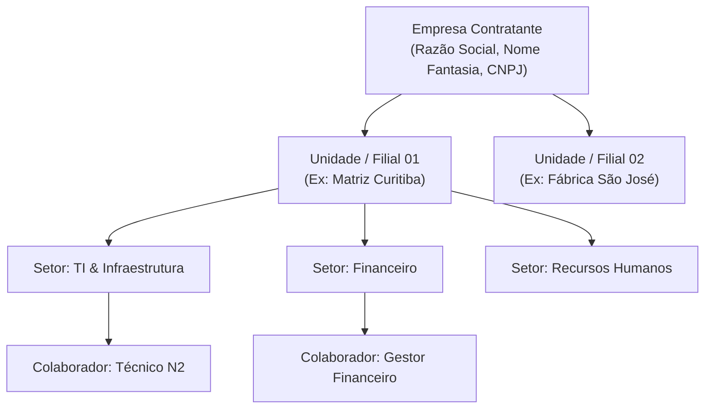

# 03. Configuração Administrativa e Governança

Este manual aborda os procedimentos que o Administrador de TI deve seguir após a conclusão do setup inicial para organizar a estrutura da organização, usuários e níveis de autorização.

---

## 1. Estrutura Organizacional

A plataforma segue um modelo corporativo hierárquico estrito:

### 1.1. Cadastrando Unidades
1. Acesse o menu lateral: **Organização > Unidades**.
2. Clique em **Nova Unidade**.
3. Preencha o Nome da Unidade (Ex: `Sede Administrativa`), Código Único (`MAT-01`) e Endereço.
4. Salve a unidade.

### 1.2. Cadastrando Setores (Departamentos)
1. Acesse **Organização > Setores**.
2. Clique em **Novo Setor**.
3. Selecione a unidade vinculada, informe o nome (Ex: `Tecnologia da Informação`) e código (`TI-01`).
4. Os setores cadastrados servem de base para roteamento automático de chamados e lotação de inventário.

---

## 2. Gestão de Colaboradores e Contas de Usuário

No sistema, existe uma distinção intencional entre:
* **Colaborador (`Employee`):** A pessoa física que trabalha na empresa (com matrícula, cargo, telefone e setor).
* **Conta de Acesso (`UserAccount`):** A credencial de autenticação digital (e-mail e senha) vinculada a um colaborador.

### 2.1. Como Criar um Novo Usuário do Sistema
1. Acesse **Organização > Colaboradores** e crie a ficha cadastral da pessoa física.
2. Acesse **Identidade > Usuários** e clique em **Novo Usuário**.
3. Selecione o colaborador correspondente, digite o e-mail corporativo e defina a senha provisória.
4. Selecione o perfil de acesso adequado (ex: `Técnico N2` ou `Gestor de TI`).

---

## 3. Matriz de Perfis e Permissões (RBAC)

O sistema opera sob o princípio do menor privilégio. Estão pré-configurados os seguintes perfis padrão:

| Perfil | Escopo de Permissões | Indicado Para |
| :--- | :--- | :--- |
| **Administrador (`ADMIN_TOTAL`)** | Acesso irrestrito a configurações, backups, integrações, auditoria e limpeza de dados. | Gerentes de TI, CISO e Sysadmins. |
| **Gestão de TI (`GESTAO_TI`)** | Visualização completa de chamados, relatórios executivos, movimentações de patrimônio e estoque. | Coordenadores e Supervisores de Suporte. |
| **Técnico N2 (`TECNICO_N2`)** | Atendimento de chamados do seu setor, lançamento de notas internas, consumo de estoque e movimentação de ativos. | Analistas de Suporte e Especialistas de Infraestrutura. |
| **Solicitante (`SOLICITANTE_PADRAO`)** | Visualização estrita dos chamados de sua autoria, abertura de tickets com formulários dinâmicos. | Usuários finais da organização. |

---

## 4. Auditoria e Rastreabilidade

Todas as ações críticas executadas por administradores e técnicos são gravadas de forma imutável na tabela de auditoria (`audit_logs`):
* Registro de alteração de senhas e logins.
* Exclusão e limpeza de registros.
* Geração e restauração de backups.
* Histórico completo de eventos de cada chamado do Service Desk.
* Para consultar: acesse **Administração > Auditoria de Eventos**.
