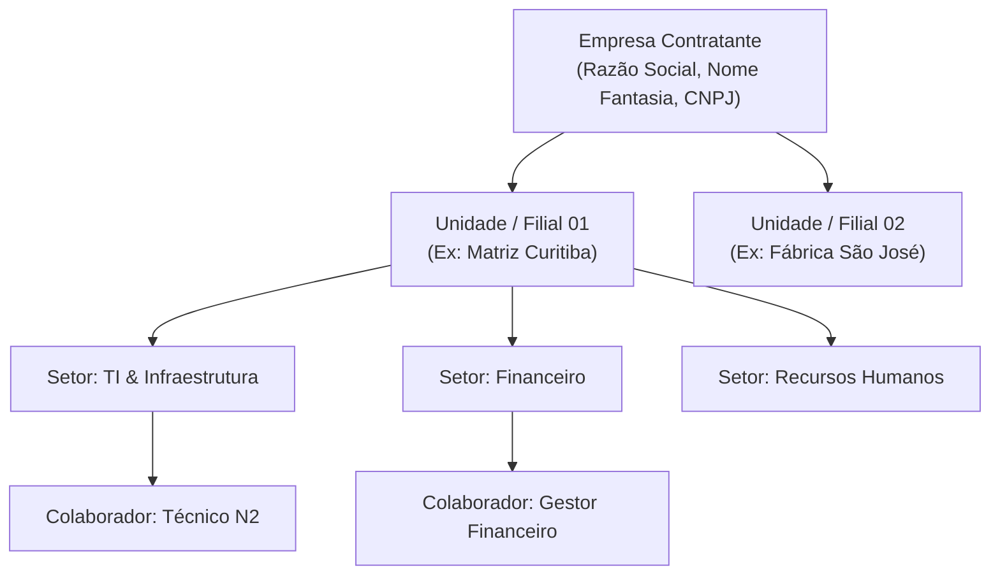

# 03. Configuração Administrativa e Governança

Este manual aborda os procedimentos que o Administrador de TI deve seguir após a conclusão do setup inicial para organizar a estrutura da organização, usuários e níveis de autorização.

---

## 1. Estrutura Organizacional

A plataforma segue um modelo corporativo hierárquico estrito:

### 1.1. Cadastrando Unidades
1. Acesse o menu lateral: **Organização > Unidades**.
2. Clique em **Nova Unidade**.
3. Preencha o Nome da Unidade (Ex: `Sede Administrativa`), Código Único (`MAT-01`) e Endereço.
4. Salve a unidade.

### 1.2. Cadastrando Setores (Departamentos)
1. Acesse **Organização > Setores**.
2. Clique em **Novo Setor**.
3. Selecione a unidade vinculada, informe o nome (Ex: `Tecnologia da Informação`) e código (`TI-01`).
4. Os setores cadastrados servem de base para roteamento automático de chamados e lotação de inventário.

---

## 2. Gestão de Colaboradores e Contas de Usuário

No sistema, existe uma distinção intencional entre:
* **Colaborador (`Employee`):** A pessoa física que trabalha na empresa (com matrícula, cargo, telefone e setor).
* **Conta de Acesso (`UserAccount`):** A credencial de autenticação digital (e-mail e senha) vinculada a um colaborador.

### 2.0. Dados da empresa e logomarca

Em **Organização > Empresa** (permissão de leitura/edição da empresa) altere o nome e o CNPJ e envie a logomarca (PNG, JPEG ou WebP, até 2 MB). O nome e a logo aparecem no menu lateral e na tela de login.

### 2.1. Como Criar um Novo Usuário do Sistema
1. Acesse **Organização > Colaboradores** e crie a ficha cadastral da pessoa física.
2. Acesse **Identidade > Usuários** e clique em **Novo Usuário**.
3. Selecione o colaborador correspondente, digite o e-mail corporativo e use a senha provisória **aleatória já sugerida** (ou digite outra); informe-a ao usuário por canal seguro. O sistema o obriga a trocá-la no primeiro acesso.
4. Selecione o perfil de acesso adequado (ex: `Técnico N2` ou `Gestor de TI`).

**Redefinir a senha de alguém:** em **Identidade > Usuários**, use o botão *Resetar Senha*: o sistema gera uma senha temporária aleatória, mostrada **uma única vez** para você copiar; a sessão aberta do usuário é encerrada e ele precisa trocar a senha ao entrar. **Recuperação por e-mail:** o próprio usuário pode pedir um link em "Esqueci minha senha" quando o administrador ativa o recurso (**Canais de comunicação > E-mail**; exige SMTP com TLS testado). Veja [ADR-018](decisions/ADR-018-recuperacao-de-senha.md).

Quem tem apenas permissão de editar usuários **não** pode conceder o papel de administrador, dar permissões que não possui nem alterar a conta de um administrador; o último administrador ativo não pode ser inativado ou rebaixado.

---

## 3. Perfis, permissões e acesso efetivo

O sistema opera sob o princípio do menor privilégio. O catálogo único de permissões (código, módulo, rótulo em
português, descrição e risco) fica em `backend/app/identity/permission_catalog.py`. Perfis criados pelo seed
(cumulativos; perfis já existentes não são sobrescritos):

| Perfil | O que acrescenta |
| :--- | :--- |
| **Solicitante** | Abrir chamados, ver os próprios chamados e os próprios ativos. |
| **Atendente** | Atender os chamados do seu setor, notas internas, categorias de chamados, ver ativos e estoque. |
| **Gestão** | Ver todos os chamados, relatórios, inventários, auditoria, organização (leitura) e exportar dados. |
| **Admin** | Cadastro e movimentação de ativos, categorias, importação do GLPI, estoque, organização, usuários, perfis e SLA. |
| **Administrador** | Todas as permissões comuns. |

**Permissões críticas** (backups, download de backup, dados de demonstração, zerar a base, importação de dados e
conceder críticas) não entram em perfil nem valem pelo simples "Administrador": são concedidas a cada pessoa. Ver
`docs/09`, seção 2.

**Abertura de chamados: solicitante, criador e setor.**
* **Solicitante** é a pessoa para quem o pedido é feito; **criador** é quem abriu. Por padrão são a mesma pessoa.
  Abrir em nome de outro colaborador exige **Abrir chamados em nome de outra pessoa**
  (`service_desk.tickets.create_on_behalf`, sem concessão automática: marque no perfil de quem precisa). Solicitante e
  criador acompanham o chamado, comentam em público e podem finalizá-lo; o criador fica registrado no chamado e na
  auditoria.
**Telas:**
* **Perfis** (*Administração & Sistema > Perfis*): ao criar ou editar um perfil, as permissões aparecem agrupadas por
  módulo, com nome em português, descrição e o risco (Leitura, Alteração, Execução, Administração). As críticas não
  aparecem ali. Se a lista de permissões não carregar, o perfil não pode ser salvo (salvar apagaria as permissões dele).
* **Usuários** → botão **Acesso** (ícone de escudo): mostra o **acesso efetivo** da conta, calculado pelo servidor com a
  mesma regra da autorização — cada permissão que ela tem e de onde vem (perfil, "Administrador" ou concessão
  individual) — e as permissões críticas concedidas. Quem tem `identity.critical.grant` concede (com motivo) e revoga
  críticas ali mesmo; a pessoa precisa entrar de novo para a concessão valer.

--- | :--- | :--- |
| **Administrador (`ADMIN_TOTAL`)** | Acesso irrestrito a configurações, backups, integrações, auditoria e limpeza de dados. | Gerentes de TI, CISO e Sysadmins. |
| **Gestão de TI (`GESTAO_TI`)** | Visualização completa de chamados, relatórios executivos, movimentações de patrimônio e estoque. | Coordenadores e Supervisores de Suporte. |
| **Técnico N2 (`TECNICO_N2`)** | Atendimento de chamados do seu setor, lançamento de notas internas, consumo de estoque e movimentação de ativos. | Analistas de Suporte e Especialistas de Infraestrutura. |
| **Solicitante (`SOLICITANTE_PADRAO`)** | Visualização estrita dos chamados de sua autoria, abertura de tickets com formulários dinâmicos. | Usuários finais da organização. |

---

## 3.1. SLA de chamados (prazos de atendimento)

Tela *Service Desk > SLA (prazos)*, para quem tem **Gerenciar SLA** (`service_desk.sla.manage`; o perfil Administrador já tem; num perfil Admin criado antes desta versão, marque em *Perfis*). Regras completas em
[ADR-017](decisions/ADR-017-sla.md).

1. **Calendários** (aba *Calendários*): o expediente de cada dia da semana (pode ter mais de um intervalo, ex.: 08:00–12:00
   e 13:00–18:00), o fuso e os feriados. Os prazos só correm dentro do expediente. A instalação já traz o calendário
   "Horário comercial" (segunda a sexta, 08:00–18:00).
2. **Políticas** (aba *Políticas*): prazo de **primeira resposta** e de **resolução** para cada prioridade, em horas úteis
   (0,5 = 30 min); prioridade sem prazo não tem relógio. Também: o **alerta** de proximidade (padrão 80% do prazo; 0
   desliga), o que fazer ao **reabrir** (recomeçar o prazo de resolução ou continuar de onde parou) e em quais status o
   relógio **para** (Pendente e, se quiser, Em atendimento). A política "Padrão" vem **inativa**.
3. **Ligar à categoria:** em *Categorias de Chamados*, campo **SLA** (padrão "Não se aplica"). A política precisa estar
   **ativa** para ligar o relógio.

Tudo vale para **chamados novos**: os que já estão abertos guardaram os prazos de quando começaram. O selo no cabeçalho
do chamado mostra a situação (no prazo, pausado, cumprido, violado) e o próximo prazo. Os avisos (*perto de vencer* e
*violado*) saem pelo hub de notificações; as regras ficam em *Notificações > Entregas e regras*.

## 4. Auditoria e Rastreabilidade

Ações críticas são gravadas na tabela `audit_logs` e consultadas em **Administração & Sistema > Auditoria** (permissão `audit.read`), com filtros por evento, usuário (trecho do e-mail) e período, e paginação:
* Logins (sucesso, falha, conta bloqueada), criação/alteração/inativação de usuários, perfis, redefinição e troca de senha, recuperação de senha, dados da empresa e configuração de SMTP.
* Histórico dos eventos de cada chamado do Service Desk (inclui vínculo, reserva, entrega e devolução de ativos e materiais), colaborador criado e backup concluído/falho.
* Senhas, tokens e o texto digitado no campo de e-mail do login **nunca** são registrados.
* Não são auditados: logout, restauração de backup feita por script, importação/exportação e leituras. Detalhes e limites em [09](09-seguranca-e-auditoria.md).

---

## 5. Modelo do Termo de Responsabilidade

O termo impresso no detalhe do ativo ("Termo de Responsabilidade e Cautela") usa um modelo de texto. Sem nenhuma alteração vale o **modelo padrão do sistema**; uma empresa que tem o próprio texto pode editá-lo.

**Onde:** *Patrimônio e Ativos* → botão **Modelo do termo** (exige a permissão `organization.company.update`; quem só tem `assets.write` não vê o botão).

- O texto é editado como **texto simples**, sem HTML. O visual (tabelas, assinaturas) é padronizado pelo sistema.
- **Campos automáticos** (clique para inserir): `{{colaborador}}`, `{{matricula}}`, `{{cargo}}`, `{{setor}}`, `{{unidade}}`, `{{patrimonio}}`, `{{categoria}}`, `{{equipamento}}`, `{{empresa}}`, `{{data}}`.
- **Blocos prontos** (sozinhos em uma linha): `{{tabela_colaborador}}`, `{{tabela_equipamento}}`, `{{tabela_especificacoes}}` e `{{assinaturas}}`.
- **Formatação:** `# Título`, `> Subtítulo`, `## Seção`, listas com `1.` ou `-`, `**negrito**`; linha em branco separa parágrafos.
- **Ver prévia** abre o termo com dados de exemplo, sem salvar. **Salvar modelo** passa a valer para todos os termos gerados a partir daí (não altera termos já impressos). **Voltar ao modelo padrão** apaga o modelo próprio.
- Campos escritos errados (por exemplo `{{matricula_errada}}`) são avisados na tela e aparecem como escritos no documento.
- Cada alteração e cada restauração ficam na auditoria (`assets.statement_template_changed`), sem o texto do modelo.

Limite: 20.000 caracteres. O cabeçalho do rodapé ("Documento gerado eletronicamente em ... ID Ativo ...") é fixo.
