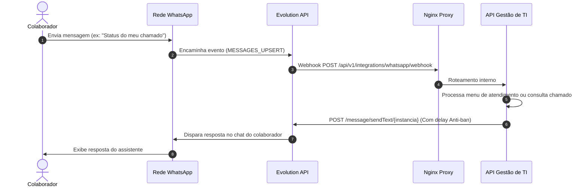

# 04. Configuração de Integrações (WhatsApp & E-mail SMTP)

Este documento detalha o funcionamento, parametrização segura e testes de conectividade das duas principais integrações da plataforma: **Evolution API (WhatsApp)** e **Notificações por E-mail (SMTP)**.

---

## 1. Servidor de E-mail (SMTP) — Notificações Transacionais

O módulo de e-mail é responsável por alertar os usuários sobre o ciclo de vida dos chamados no Service Desk.

### 1.1. Configuração dos Parâmetros SMTP
1. Acesse **Administração > Servidor de E-mail (SMTP)**.
2. Ative a chave **Notificações por E-mail**.
3. Preencha os dados do provedor da empresa:
   * **Servidor (Host):** Ex: `smtp.gmail.com`, `smtp.office365.com` ou servidor interno Postfix.
   * **Porta:** `587` (STARTTLS) ou `465` (SSL/TLS).
   * **Segurança da Conexão:** Selecione `STARTTLS` ou `SSL_TLS`.
   * **Usuário / E-mail de Autenticação:** Conta de envio (Ex: `suporte@empresa.com.br`).
   * **Senha / App Password:** Digite a senha de aplicativo gerada no provedor.
   * **E-mail do Remetente (From):** Endereço que constará no cabeçalho.
   * **Nome de Exibição:** Ex: `Service Desk - Gestão de TI`.
   * **URL Base da Plataforma:** URL pública da instalação (Ex: `https://chamados.empresa.com.br`) usada para gerar links diretos nos e-mails.
4. Clique em **Salvar Parâmetros SMTP**.
   > *Nota de Segurança:* As credenciais são armazenadas criptografadas na tabela `system_settings` e a senha é mascarada (`********`) no retorno de APIs e interfaces.

### 1.2. Teste de Envio de Validação
Antes de ativar as notificações em ambiente de produção:
1. No card **Validação de Conectividade**, informe seu e-mail no campo **E-mail de Destino para Teste**.
2. Clique no botão **Enviar E-mail de Teste**.
3. O sistema executará o handshake TLS, autenticação SMTP e o envio de uma mensagem de validação contendo carimbo de data e hora.

### 1.3. Regra de Privacidade e Sigilo DEC-012
A plataforma implementa a política de privacidade **DEC-012**:
* Quando um técnico adiciona uma **Nota Interna (`is_internal = True`)**, essa mensagem é estritamente sigilosa. O sistema **JAMAIS** envia notificação por e-mail para o solicitante.
* Apenas **respostas públicas** (`is_internal = False`) disparam alertas para o cliente solicitante.
* Quando o solicitante responde no chamado, o técnico responsável atribuído é notificado por e-mail com link de acesso rápido.

---

## 2. Integração com Evolution API (WhatsApp)

A plataforma se comunica com a **Evolution API v1/v2** para disponibilizar atendimento automatizado, abertura de chamados e consulta de status via WhatsApp.

### 2.1. Arquitetura da Integração

### 2.2. Configuração da Instância
1. Acesse **Administração > WhatsApp & Anti-Ban > Conexão & Gateway**.
2. Selecione o provedor: `Evolution API (Recomendado)`.
3. Preencha os campos:
   * **URL Base da API:** `http://gestao-ti-evolution:8084` (na rede Docker interna) ou `https://wa.empresa.com.br`.
   * **Nome da Instância:** Identificador criado para a empresa (Ex: `suporte_ti`).
   * **Chave de API (API Key):** Token secreto configurado na Evolution API.
4. Clique em **Salvar Configurações**.

### 2.3. Pareamento com QR Code
1. Clique no botão **Conectar WhatsApp (QR Code)** disponível no banner de status da conexão.
2. O sistema consultará a Evolution API (`GET /instance/connect/{instancia}`) e renderizará o QR Code em tela.
3. No smartphone com o número do WhatsApp corporativo:
   * Abra o WhatsApp > **Aparelhos conectados** > **Conectar um aparelho**.
   * Aponte a câmera para o QR Code na tela.
4. Após o pareamento, o status no painel passará para **CONNECTED**.

### 2.4. Configuração do Webhook na Evolution API
No painel ou API da Evolution API, cadastre a URL de webhook do sistema:
* **Webhook URL:** `http://SEU_DOMINIO/api/v1/integrations/whatsapp/webhook`
* **Eventos Habilitados:** `MESSAGES_UPSERT`

### 2.5. Escudo de Proteção Anti-Ban
Para proteger o número corporativo de bloqueios acidentais pela Meta:
* **Delays Dinâmicos:** Intervalo configurável entre 4s e 10s entre envios sucessivos com jitter aleatório.
* **Simulação de Digitação (`presence: composing`):** Envia indicador visual de "digitando..." antes do texto final.
* **Taxa Limite:** Máximo de mensagens por minuto por destinatário.
* **Kill Switch de Emergência:** Pausa imediatamente todas as mensagens da fila de saída caso ocorra qualquer anomalia.
