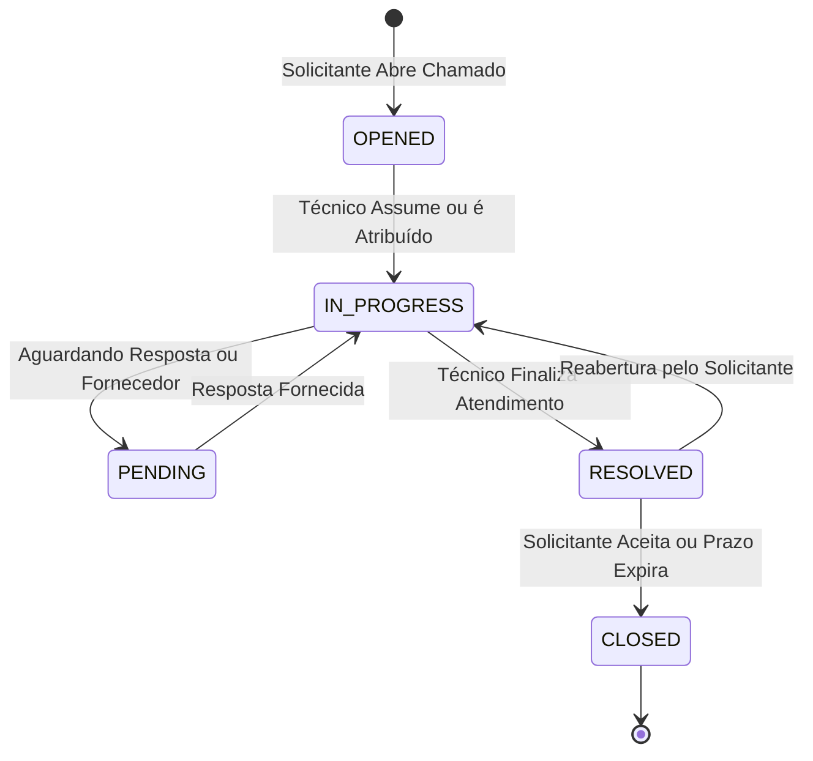

# 06. Manual de Utilização e Atendimento (Service Desk)

Este manual descreve o fluxo de trabalho operacional para solicitantes, técnicos de suporte e coordenadores de TI dentro do módulo de Service Desk.

---

## 1. Ciclo de Vida do Chamado

Os chamados transitam por uma máquina de estados controlada:

* **OPENED (Aberto):** Chamado registrado no sistema, aguardando triagem ou atribuição a um técnico.
* **IN_PROGRESS (Em Atendimento):** O analista assumiu o chamado e está trabalhando na resolução.
* **PENDING (Pendente):** O atendimento depende de uma resposta do usuário ou envio de insumos por fornecedor externo.
* **RESOLVED (Resolvido):** O problema foi solucionado pelo técnico, aguardando validação do solicitante.
* **CLOSED (Encerrado):** Chamado finalizado em definitivo. Não aceita novas interações ou alterações.

---

## 2. Abertura de Chamados com Formulários Dinâmicos

1. O colaborador acessa o portal e clica em **Novo Chamado**.
2. Seleciona a **Categoria do Chamado** (ex: *Suporte a Estações de Trabalho*, *Acessos e Senhas*, *Rede e Conectividade*).
3. Cada categoria carrega automaticamente seu **formulário de pré-requisitos dinâmicos** (ex: *Tipo de Equipamento*, *Número de Patrimônio*, *Sistema Afetado*).
4. O usuário preenche o Título, Descrição detalhada e anexa evidências (prints, logs ou documentos PDF).
5. O chamado é direcionado para a fila de atendimento do setor responsável definido na categoria.

---

## 3. Atendimento e Respostas Técnicas

### 3.1. Respostas Públicas vs. Notas Internas
Ao responder dentro de um chamado, o técnico pode escolher entre dois tipos de registro:

| Tipo | Visibilidade | Notificação por E-mail |
| :--- | :--- | :--- |
| **Resposta Pública** | Visível para o Solicitante, Gestor e Atendentes. | Dispara e-mail com link do chamado para o solicitante. |
| **Nota Interna** | Visível **apenas** para a equipe técnica e administradores. | **Regra DEC-012:** O solicitante **NUNCA** recebe notificação desta nota. |

### 3.2. Vinculação de Ativos e Consumo de Estoque
Durante o atendimento:
* **Vincular Ativo:** Se o atendimento refere-se a um notebook ou servidor cadastrado, o técnico pode associar o ativo na aba lateral.
* **Consumir Peça de Estoque:** Se foi necessário substituir um componente (ex: *SSD 500GB*, *Cabo de Rede*), o técnico lança o insumo diretamente no chamado. O estoque é deduzido em tempo real e o custo fica atrelado ao histórico do ticket.

---

## 4. Finalização e Encerramento

1. O técnico altera o status para **RESOLVED** e descreve o parecer técnico da solução.
2. O solicitante recebe um e-mail com a confirmação da solução e link para validação.
3. Se o solicitante confirmar a resolução, o status muda para **CLOSED**.
4. Caso a solução não seja satisfatória, o solicitante pode responder no chamado, retornando o ticket para **IN_PROGRESS**.
