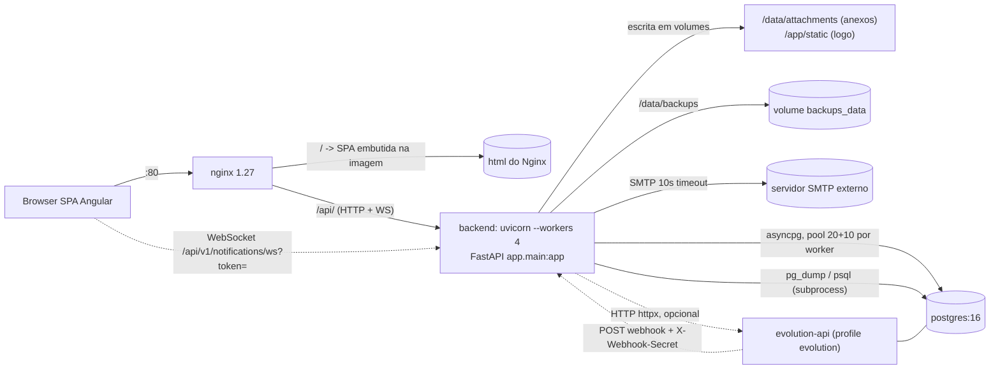
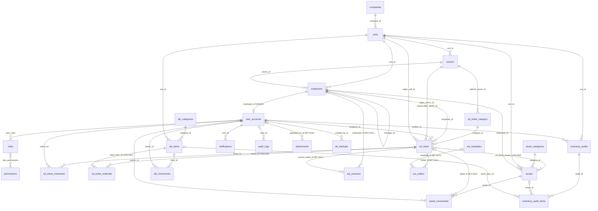

# PROJECT_MAP — Plataforma de Gestão de TI

> Mapa operacional do repositório. Base original: commit `a544af7` (2026-10-14). Atualizado na Fase 0 (branch `fix/phase-0-hardening`): deploy, anexos, auth, WhatsApp, backup/restore, estoque, auditoria.
> **Fonte de verdade = código.** Cada afirmação foi conferida lendo o arquivo citado (`caminho:linha`).
> Marcadores: **(exec)** = confirmado executando; **(inf)** = inferido, não confirmado.
> Quando o código diverge de README/ROADMAP/docs, vale o código — ver seção 10.
> Falhas e riscos detalhados ficam em `docs/AUDIT.md` (Fase 2); aqui só o que muda como se navega ou edita o sistema.

---

## 1. Visão geral

Service desk + patrimônio (ativos) + estoque de insumos + inventário periódico, **single tenant** (uma `Company`), com bot de WhatsApp. Backend FastAPI (Python 3.12) com SQLAlchemy 2.0 async; frontend Angular SPA; PostgreSQL 16; Nginx; Docker Compose.

### Perfis (roles semeadas em `backend/app/seed.py:163-225`)

| Role | Pode (resumo) |
|---|---|
| `Solicitante` | abrir/acompanhar os próprios chamados; ver os próprios ativos (`assets.read_own`) |
| `Atendente` | Solicitante + atender chamados do setor (`service_desk.tickets.manage`), notas internas, ler ativos/estoque |
| `Gestão` | Atendente + ver todos os chamados, relatórios, inventário, leitura de organização, exportar CSV |
| `Admin` | Gestão + escrever ativos/estoque/organização/usuários/perfis |
| `Administrador` | todas as permissões; o 1º usuário (setup) também recebe a flag `is_admin=True`, que ignora qualquer checagem de permissão (`core/dependencies.py:75-88`) |

Usuário sem `Employee` vinculado não abre chamado (`service_desk/router.py:206`).

### Módulos

| Estado | Módulo | Observação |
|---|---|---|
| **Ativo** | `core` (config, events, exceptions, security, demo), `organization`, `identity`, `service_desk`, `assets`, `movements`, `stock`, `inventory_audit`, `attachments`, `notifications` (REST + WS + e-mail), `audit`, `data_transfer`, `backup`, `whatsapp` | montados em `app/main.py:122-168` |
| **Morto** | `access_control` | só `__init__.py`; router comentado em `main.py:143-144`, models comentados em `alembic/env.py:27`. ROADMAP o marca ✅ |
| **Morto (parcial)** | `NotificationService.create_notification` (`notifications/services.py:52`) | **nenhum chamador** em `app/`; o sino do header nunca recebe notificação gerada pelo sistema |
| **Morto** | `WhatsAppNotificationDispatcher` (`whatsapp/notification_dispatcher.py`) | zero referências em `app/` e `tests/` |
| **Morto** | `core/pagination.py` (`PaginatedResponse`, `get_pagination_params`) | zero usos; todas as listagens retornam array sem paginação |
| **Morto** | `app/check_registry.py`, `backend/seed_service_desk.py`, `tests/` na raiz (3 scripts contra `http://localhost`) | scripts avulsos; os de raiz não rodam no CI |
| **Morto** | Configs `TICKET_REOPEN_DAYS`, `BACKUP_RETENTION_DAYS` | definidas em `config.py`, nunca lidas (as `ATTACHMENT_*` passaram a valer na Fase 0) |
| **Planejado (só doc/UI)** | Contas e acessos (MOD-09), notificações multicanal | ver `docs/AUDIT.md` e ADR da Fase 3 |

Frontend: 129 arquivos em `frontend/src`, rotas lazy em `frontend/src/app/app.routes.ts`. Sem módulo de notificações dedicado além do sino em `core/layout/header`.

---

## 2. Arquitetura

### 2.1 Containers e requisição



Fatos que o diagrama não mostra:

- Nginx roteia `/api/`, o WebSocket `/api/v1/notifications/ws` (timeout longo), `/static/` (proxy para o backend, com `nosniff` e CSP restritiva) e `/` com fallback SPA.
- `backend` e `postgres` **não** publicam portas no host (só o Nginx); `docker-compose.dev.yml` as expõe em 127.0.0.1 para desenvolvimento.
- O código roda da imagem (sem bind mount); dados em volumes nomeados (`postgres_data`, `attachments_data`, `backups_data`, `static_data`). O backend roda como usuário não-root.
- 4 workers uvicorn (`backend/Dockerfile:38`) × pool 20+10 (`app/database.py:23-25`) = até 120 conexões; o default do Postgres é `max_connections=100` (inf).
- Estado em memória por worker: `NotificationConnectionManager.active_connections` (`notifications/services.py:15-46`), `lru_cache` de settings.

### 2.2 Camadas por módulo

Padrão declarado e seguido pela maioria: `models.py → schemas.py → repository.py → services.py → router.py`.

```
router (FastAPI Depends, permissão) -> service (regra de negócio) -> repository (SQLAlchemy select/flush) -> models
```

Transação: `get_db` (`app/database.py:41-58`) faz `commit` ao fim da request e `rollback` em exceção.

### 2.3 Onde o padrão é violado

| Violação | Evidência |
|---|---|
| Router com regra de negócio e SQL | `service_desk/router.py:32-70` (`get_user_context` faz `select(Employee)`); `whatsapp/router.py` inteiro (CRUD de templates/config/outbox sem service) |
| Router decide autorização por `payload` manual em vez de `require_permission` | `service_desk/router.py:32-70`, `assets/router.py:77-99,121-149`, `attachments/router.py:23-52` |
| Service chama `repo.session` (quebra o encapsulamento) | `assets/services.py:171,177,183` |
| Repository faz `commit` (fronteira de transação no lugar errado) | `notifications/repository.py:17,45,55`; `backup/services.py:81,102`; `whatsapp/queue_service.py:241` |
| Router também faz `commit` (duplica `get_db`) | `service_desk/router.py:100,119,218,243,293,324,357,386,411,441` |
| Acoplamento cruzado de módulos e import dentro de função para fugir de ciclo | 78 imports `from app...` indentados em 14 arquivos (ex.: `service_desk/services.py:195,415,507-510`; `attachments/router.py:34-35`; `main.py:122-168`) |
| Model importa model de outro módulo no topo | `organization/models.py:22` (`StockItem`), `assets/models.py:21` (`Employee, Unit`), `identity/models.py:19` |
| Dois mecanismos de auditoria coexistem | `service_desk` grava direto em `AuditRepository` (mesma transação, única escrita desde a Fase 0); `organization` ainda emite no `event_bus`, cujo listener global (`audit/listener.py`) grava em sessão própria. Será unificado pelo outbox (ADR-013) |
| Módulos sem service/repository | `whatsapp` (parte), `backup` (service sem repository), `data_transfer`, `core/demo_*` |

---

## 3. Mapa de módulos

Prefixo global `API_V1_PREFIX=/api/v1` (`config.py:28`). Permissão: `P:x` = `require_permission("x")`; `JWT` = qualquer token válido; `ctx` = regra manual no corpo; `—` = **sem autenticação**.

| Módulo | Responsabilidade | Arquivos principais | Tabelas |
|---|---|---|---|
| `core` | settings, engine, JWT/bcrypt, exceções, event bus, mixins, modo demo | `config.py`, `database.py`, `core/{security,dependencies,events,exceptions,soft_delete,timestamps,settings_model,demo_service,demo_router}.py` | `system_settings` |
| `organization` | empresa, unidades, setores, colaboradores, logo | `organization/{models,router,services,repository}.py` | `companies`, `units`, `sectors`, `employees` |
| `identity` | setup inicial, login, usuários, perfis, permissões | `identity/{models,router,services,repository}.py` | `user_accounts`, `roles`, `permissions`, `user_roles`, `role_permissions` |
| `service_desk` | chamados, categorias com form dinâmico, interações, materiais, ciclo de ativos por chamado, histórico, relatório | `service_desk/{models,router,services,repository}.py` | `sd_ticket`, `sd_ticket_category`, `sd_ticket_interaction`, `sd_ticket_materials`, `sd_ticket_assets` |
| `assets` | categorias e ativos (JSONB `technical_specs`), termo de responsabilidade | `assets/{models,router,services,repository}.py` | `asset_categories`, `assets` |
| `movements` | máquina de estados do ativo + histórico | `movements/services.py:24-152` | `asset_movements` |
| `stock` | insumos por unidade, categorias, movimentos | `stock/{models,router,services,repository}.py` | `stk_categories`, `stk_items`, `stk_movements` |
| `inventory_audit` | inventário periódico (cabeçalho + itens conferidos) | `inventory_audit/{models,router,service,repository}.py` | `inventory_audits`, `inventory_audit_items` |
| `attachments` | upload/download/exclusão em disco, polimórfico | `attachments/{models,router,service,repository}.py` | `attachments` |
| `notifications` | in-app (REST+WS), e-mail SMTP | `notifications/{models,services,router,repository,email_service,email_router}.py` | `notifications`; config SMTP em `system_settings` |
| `audit` | trilha de eventos (listener do event bus) | `audit/{models,listener,repository,services,router}.py` | `audit_logs` |
| `data_transfer` | export/import CSV | `data_transfer/{router,export_service,import_service}.py` | — |
| `backup` | `pg_dump`/restore, retenção, SHA-256 | `backup/{models,router,services}.py` | `db_backups` |
| `whatsapp` | adapters (Mock/Evolution/Meta), máquina de estados, outbox anti-ban, templates | `whatsapp/{adapter,conversation_service,queue_service,router,models,template_service}.py` | `wa_configs`, `wa_sessions`, `wa_templates`, `wa_outbox` |

### 3.1 Endpoints

**organization** (`/organization`)

| Método | Rota | Permissão |
|---|---|---|
| GET/POST/PATCH | `/company` | `P:organization.company.read` / `.create` / `.update` |
| POST | `/company/logo` | `P:organization.company.update` (`organization/router.py:55`) |
| GET | `/company/public` | **—** (intencional: login/sidebar) |
| GET/POST, GET/PATCH/DELETE `{id}` | `/units` | `P:organization.units.read|create|update` (DELETE usa `update`) |
| idem | `/sectors` | `P:organization.sectors.*` |
| GET | `/employees/me/details` | `JWT` |
| GET/POST, GET/PATCH/DELETE `{id}` | `/employees` | `P:organization.employees.*` |

**identity** (`/identity`) — `identity/router.py`

| Método | Rota | Permissão |
|---|---|---|
| GET | `/setup/status` | **—** |
| POST | `/setup` | **—** (só funciona com 0 usuários) |
| POST | `/login` | **—** (form OAuth2) |
| GET | `/me` | `JWT` |
| POST | `/me/password` | `JWT` |
| GET | `/permissions` | `P:identity.roles.read` |
| GET/POST/GET{id}/PATCH/DELETE | `/users` | `P:identity.users.read|create|update` |
| PATCH | `/users/{id}/password` | `P:identity.users.update` |
| GET/POST/GET{id}/PATCH/DELETE | `/roles` | `P:identity.roles.read|create|update` |

**service_desk** (`/tickets`) — `service_desk/router.py`. **Nenhuma rota usa `require_permission`**; a autorização é `ctx` (`get_user_context`, `:32-70`) derivada do JWT:

| Método | Rota | Regra |
|---|---|---|
| GET | `/categories` | `JWT` (corrigido na Fase 0) |
| POST/PATCH | `/categories`, `/categories/{id}` | `ctx.is_technician` |
| GET | `` | `can_read_all` (só `read_all`/admin) vê tudo; técnico: setor responsável + atribuídos + os que abriu; demais: só os próprios |
| GET | `/reports/summary` | `ctx.can_view_reports` (`is_admin` ou `service_desk.reports.read`) |
| GET | `/{id}` , `/{id}/history` | `get_ticket_for_user` (`services.py:79-119`) |
| POST | `` | exige `employee_id` |
| PATCH | `/{id}` | técnico do setor/atribuído **ou** solicitante (só RESOLVED/CLOSED) |
| POST | `/{id}/interactions` | `get_ticket_for_user`; nota interna exige técnico/`interactions.internal` |
| POST | `/{id}/materials` | `is_technician` (baixa estoque via `StockService`) |
| POST | `/{id}/assets/{asset_id}/reserve|deliver|return|inspect` | `is_technician` **e** visibilidade do chamado (`get_ticket_for_user`); body tipado (`TicketAssetActionRequest`/`TicketAssetInspectRequest`); não exige `assets.write` |

**assets** (`/assets`) — `assets/router.py`

| Método | Rota | Permissão |
|---|---|---|
| GET/POST/PUT/DELETE | `/categories[/{id}]` | `P:assets.read` / `P:assets.write` |
| GET | `` | `P:assets.read` |
| GET | `/me` | `JWT` |
| GET | `/{id}` | `assets.read` **ou** `assets.read_own` + dono (manual, `:77-99`) |
| POST/PUT | `` , `/{id}` | `P:assets.write` |
| GET | `/{id}/responsibility-statement` | idem GET `/{id}` (HTML gerado na hora) |

**movements** (`/movements`) — `P:assets.read` (GET `/asset/{id}`), `P:assets.write` (POST `/`, `/{id}/reserve|cancel-reservation|deliver|return|inspect`). **stock** (`/stock`) — `P:stock.read|write` em categorias, itens e `/movements`. **inventory** (`/inventory`) — `P:inventory.read` (GET) / `P:inventory.write` (POST, PATCH, itens).

**attachments** (`/attachments`) — `attachments/router.py`

| Método | Rota | Autorização |
|---|---|---|
| POST | `` (multipart: `file`, `entity_type`, `entity_id`) | `JWT` + `verify_entity_access` |
| GET | `?entity_type=&entity_id=` | idem |
| GET | `/{id}/download` | idem (usa `entity_type` do registro) |
| DELETE | `/{id}` | idem |

`entity_type` é enum fechado (`TICKET`, `ASSET` → 422 para outros); a regra por entidade está em `attachments/access.py` (ver 6.5).

**notifications** — `GET /notifications`, `POST /notifications/{id}/read`, `POST /notifications/read-all` (`JWT`, escopo do usuário); `WS /notifications/ws?token=` (JWT na query string, `notifications/router.py:57-76`); `GET|PUT /notifications/email/config`, `POST /notifications/email/test` com `P:system.backup.manage` (permissão reaproveitada).

**audit** — `GET /audit`, `GET /audit/{entity_type}/{entity_id}` com `P:audit.read` (perfil Gestão passa a acessar).

**system** — `POST /system/export` `P:system.data.export`; `POST /system/import/analyze|execute` `P:system.data.import`; `POST /system/backups/generate`, `GET /system/backups`, `GET .../{id}/verify`, `DELETE .../{id}` `P:system.backup.manage` (**o restore saiu da API**, ver 6.8); `GET .../{id}/download` `P:system.backup.download`; `GET /system/demo/status` `P:system.data.export`; `GET /system/demo/preview-clean`, `POST /system/demo/clean`, `POST /system/demo/seed` `P:system.backup.manage`.

**whatsapp** (`/integrations/whatsapp`) — `whatsapp/router.py`

| Método | Rota | Permissão |
|---|---|---|
| POST | `/webhook` | cabeçalho `X-Webhook-Secret` (`wa_configs.webhook_secret`); responde só `{"status":"accepted"}` |
| GET/PATCH | `/config`; GET `/status`, `/qrcode`; POST `/emergency-pause`, `/test-send` | `P:integrations.whatsapp.manage` |
| GET | `/templates`; POST `/templates/{id}/preview` | `P:integrations.whatsapp.manage` ou `P:service_desk.tickets.manage` |
| POST/PUT/DELETE | `/templates[/{id}]` | `P:integrations.whatsapp.manage` |
| GET/POST | `/outbox`, `/outbox/stats`, `/outbox/process`, `/outbox/{id}/cancel|retry` | `P:integrations.whatsapp.manage` |
| POST | `/tickets/{id}/send` | `integrations.whatsapp.manage` ou `tickets.manage` **e** visibilidade do chamado |

### 3.2 Dependências entre módulos (quem importa quem)

```
service_desk -> organization, identity(repo), stock(service), assets/movements(repo+service), audit(repo), notifications(email)
whatsapp     -> service_desk(service), organization, identity(models), core
attachments  -> service_desk(service) (só para TICKET), identity(repo)
assets       -> movements(models/repo), organization(models)
movements    -> assets(models/repo)          # ciclo assets<->movements resolvido com imports tardios
organization -> stock(models)                # Unit.stock_items
core/demo    -> quase todos (limpeza em cascata manual)
```

### 3.3 Eventos

`core/events.py`: `EventBus` in-process, síncrono, handlers em sequência; falha de handler é logada e engolida (`:115-122`).

| Emissor | Eventos | Consumidor |
|---|---|---|
| `service_desk/services.py:824` | `ticket.created`, `ticket.status_changed`, `ticket.closed`, `ticket.priority_changed`, `ticket.assigned`, `ticket.interaction_added`, `ticket.material_added`, `ticket.asset_reserved|delivered|returned|inspected` | só `audit.listener` (`subscribe_all`, registrado em `main.py:41`) |
| `organization/services.py:227` | 1 evento | idem |
| `identity/services.py` | importa o bus, sem emissão relevante | — |

Nenhum evento de ativos, movimentos, estoque, backup, WhatsApp ou inventário.

---

## 4. Modelo de dados



### 4.1 Vínculos polimórficos (sem FK)

| Tabela | Colunas | Valores | Consequência |
|---|---|---|---|
| `attachments` | `entity_type` (string livre) + `entity_id` (UUID) | front usa `TICKET`, `ASSET`; comentário cita `TICKET_INTERACTION` (`attachments/models.py:24`) | sem integridade; `entity_type` vira nome de pasta (`attachments/service.py:28`) |
| `audit_logs` | `entity_type` + `entity_id` | `"ticket"` (minúsculo) e outros | histórico de chamado lê `entity_type == "ticket"` (`service_desk/services.py:710`) |
| `notifications` | `entity_type`, `entity_id` opcionais | — | — |
| `inventory_audit_items` | `item_type` (`ASSET`/`STOCK`) + duas FKs nulas | — | nada impede ambas nulas ou ambas preenchidas |

### 4.2 Exclusão

| Estratégia | Onde |
|---|---|
| `SoftDeleteMixin` (`is_active` + `deleted_at`, `core/soft_delete.py`) | `UserAccount`, `Company`, `Unit`, `Sector`, `Employee`, `Asset`, `AssetCategory`, `Attachment`, `StockCategory`, `InventoryAudit` |
| `is_active` próprio, sem `deleted_at` | `TicketCategory` (`service_desk/models.py:32`) |
| Sem exclusão lógica | `Ticket`, `StockItem` (existe `DELETE` em `stock/router.py:88`), `Notification`, `WhatsAppTemplate` (`session.delete`, `whatsapp/router.py:361`), `DatabaseBackup` |
| Hard delete em massa | `core/demo_service.py:190-228` (tudo com `is_demo=True`), retenção de backups (`backup/services.py:318`) |

`Attachment.soft_delete` só preenche `deleted_at` (`attachments/repository.py:36-39`) e a consulta filtra por `deleted_at`; o mixin também define `is_active`, que fica `True`.

Cascatas **no banco** (FK `ondelete`): `sd_ticket_assets`, `sd_ticket_materials` (`stock_item_id` CASCADE: apagar item de estoque apaga o consumo registrado), `user_roles`, `role_permissions`; `SET NULL`: `asset_movements.ticket_id`, `attachments.uploaded_by_id`, tabelas `wa_*`. Cascatas **só no ORM**: `Ticket.interactions/materials`, `Unit.sectors/stock_items`, `Company.units`, `InventoryAudit.items`, `StockItem.movements`.

Convenção de dados: PK `UUID` (`uuid.uuid4`), timestamps UTC `TimestampMixin` (`core/timestamps.py`), status e tipos como `String` (não Enum de banco) com valores em `StrEnum` quando existe (`AssetStatus`, `MovementType`), JSONB para specs/form/contexto, flag `is_demo` em quase toda entidade de negócio.

---

## 5. Onde ficam as coisas importantes

"Sobrevive a `up --build`" assume o `docker-compose.yml` atual (volumes nomeados, sem bind mount de código).

| Item | Caminho no container | Volume / mount | Sobrevive a `up --build` | Entra no backup |
|---|---|---|---|---|
| Banco | `/var/lib/postgresql/data` | volume `postgres_data` | sim | é o objeto do backup |
| Anexos | `/data/attachments/<tipo>/<id>/<uuid>` (`ATTACHMENT_STORAGE_PATH`, `attachments/service.py`) | volume `attachments_data` | sim | **não** (copiar o volume) |
| Termos de responsabilidade | **não são armazenados**: HTML gerado na hora (`assets/services.py:161`); o "termo assinado" é um anexo `ASSET` qualquer | — | — | — |
| Logo | `/app/static/logo.<png\|jpg>` (`STATIC_DIR`, `organization/router.py`), URL `/static/...` servida pelo Nginx via proxy | volume `static_data` | sim | **não** (só o `logo_url` no banco) |
| Backups | `/data/backups/backup_gestao_ti_<ts>.sql.gz` (`BACKUP_STORAGE_PATH`) | volume `backups_data` | sim | n/a; mesmo host do banco |
| Configuração (env) | `Settings` em `config.py`, `.env` na raiz (não versionado) | — | `.env` fica no host | não |
| Configuração (banco) | `system_settings` (`system_mode`, `smtp_config`), `wa_configs` | `postgres_data` | sim | sim (dentro do dump) |
| Segredos de integração | senha SMTP em texto puro no JSONB de `system_settings`; `wa_configs.api_key` e `webhook_secret` em texto puro; `WhatsAppConfigResponse` não devolve esses dois campos | `postgres_data` | sim | sim, em claro, dentro do `.sql.gz` |
| Segredo JWT | `SECRET_KEY` (env, obrigatória, ≥ 32 caracteres) | — | `.env` | não |
| Logs | stdout/stderr do container (`logging` sem configuração central) | `docker logs` | perdidos ao recriar o container | não |
| Migrations | `backend/alembic/versions/` (14 revisões, cabeça única `i9d0e1f2a3b4`) | no repo | sim | n/a |
| Seed | `backend/app/seed.py` (permissões, roles **só se não existirem**, categorias de estoque, templates WA, empresa); `seed_demo.py` e `core/demo_service.py` (demo) | no repo | sim | n/a |
| Sessões WhatsApp (Evolution) | `/evolution/instances` + schema `evolution` no mesmo Postgres | volume `evolution_instances` | sim | o schema `evolution` entra no `pg_dump` |

## 6. Fluxos críticos

### 6.1 Login e JWT
1. SPA: `features/auth/login` → `core/auth/auth.service.ts` `POST /identity/login` (form-urlencoded).
2. `identity/router.py` `login` → `IdentityService.authenticate`: `get_user_by_email` filtra `is_active`; e-mail inexistente gasta o mesmo tempo de uma verificação bcrypt; conta bloqueada (5 falhas → 15 min) responde 429 `ACCOUNT_LOCKED`; falha incrementa `failed_login_count` e **commita antes de responder**; sucesso zera o contador.
3. `_issue_token` assina HS256 com `sub`, `roles`, `permissions[]`, `is_admin`, `must_change_password`; expiração `JWT_EXPIRATION_HOURS=8`.
4. SPA guarda o token em `localStorage` e `jwt.interceptor.ts` injeta `Authorization: Bearer`; 401 → `logout()`.
5. Em cada request, `get_token_payload` valida assinatura **e consulta o usuário no banco** (ativo, `is_admin`, `must_change_password`); permissões continuam as do token (7.1).
6. IP do login vem de `X-Forwarded-For` sem validação de proxy confiável (`dependencies.py`).

### 6.2 Setup inicial
`GET /identity/setup/status` → `POST /identity/setup` (`identity/services.py`). Só cria se `count_users()==0`. Modo `DEMO` chama `DemoManagementService.seed_demo_data`; modo limpo atualiza a empresa existente (nome/CNPJ informados) ou cria uma (`Company.name`). **(exec)** nome da empresa digitado no setup aparece em `/organization/company/public`. Há uma janela de corrida teórica entre duas chamadas simultâneas na instalação (inf).

### 6.3 Chamado: abertura e ciclo de vida
Abrir: `POST /tickets` → `ServiceDeskService.create_ticket` (`service_desk/services.py:147`): valida categoria ativa e `form_schema` (obrigatórios/opções), resolve `responsible_sector_id` (categoria → setor padrão), marca `is_demo` se `system_mode=DEMO`, associa `asset_ids`, grava, registra `ticket.created`.
Estados: `OPENED → IN_PROGRESS ⇄ PENDING → RESOLVED → CLOSED`. A única trava é "CLOSED não volta" (`services.py:299-300`); `TICKET_REOPEN_DAYS` não é usado. Solicitante só pode PATCH para RESOLVED/CLOSED (`:271-279`).
Interação: `add_interaction` (`:367`) respeita `is_internal`; depois dispara e-mail dentro de `try/except` que engole falha (`:412-428`).
Histórico: `get_ticket_history` (`:686`) monta a linha do tempo de `audit_logs` (`entity_type="ticket"`); notas internas filtradas por permissão.

### 6.4 Atribuição de ativo + termo de responsabilidade
1. Direto: `POST /movements/{asset_id}/deliver` ou `POST /movements/` (`ASSIGNMENT`) → `AssetMovementService.create_movement` (`movements/services.py:24`), que usa `get_asset_for_update` (`SELECT … FOR UPDATE`, `assets/repository.py:45-48`), valida a máquina de estados e grava `AssetMovement` + atualiza o ativo na mesma transação. Via chamado: `POST /tickets/{id}/assets/{aid}/deliver` → mesmo serviço com `ticket_id`.
2. Alternativa que ignora a máquina de estados: `PUT /assets/{id}` com `status`/`employee_id` (`assets/services.py:91-158`) cria movimento por inferência.
3. Termo: `GET /assets/{id}/responsibility-statement` devolve HTML (`assets/services.py`); todos os valores interpolados passam por `html.escape` (Fase 0; teste em `tests/assets/test_responsibility_statement.py`). Nada é persistido; não há registro "termo emitido" nem "termo assinado".
4. "Assinado" = anexo `ASSET` cujo nome contenha `termo/cautela/assinado/responsabilidade` ou termine em `.pdf` — lógica **no frontend** (`asset-detail.component.ts:148-163`). O backend não sabe.

### 6.5 Upload e download de anexo
`attachments.service.ts` → `POST /attachments` (multipart) → `ensure_attachment_access` (`attachments/access.py`) → `AttachmentService.upload_file` (`attachments/service.py`). `entity_type` é enum fechado (`TICKET`, `ASSET`); o nome físico é `uuid4` sem extensão, sob `ATTACHMENT_STORAGE_PATH`, com caminho resolvido e conferido contra a raiz; só tipos de `ATTACHMENT_ALLOWED_TYPES` com assinatura (magic bytes) coerente; limite `ATTACHMENT_MAX_SIZE_MB` conferido durante a leitura em chunks de 1 MB (o Nginx limita em 100 MB). Autorização: TICKET segue a visibilidade do chamado (apagar: técnico/gestão/autor do upload); ASSET exige `assets.read` (ou `assets.read_own` + dono) para ler e `assets.write` para enviar/apagar. Download: `Content-Disposition: attachment` + `nosniff`, `media_type` do registro. Delete: remove o arquivo e faz soft delete.

### 6.6 Movimentação de estoque
`POST /stock/movements` → `StockService.add_movement`: `get_item_for_update` (`SELECT … FOR UPDATE`, `stock/repository.py`) trava a linha até o commit; confere saldo, altera `quantity`, grava `StockMovement`. **(exec)** 40 saídas paralelas sobre saldo 40 → saldo final 0 (antes: 38). Teste de concorrência `tests/test_stock_concurrency.py` (marcador `pg`). Consumo via chamado usa o mesmo caminho (`service_desk/services.py`). `min_quantity` só alimenta alerta visual do dashboard; nada é emitido.

### 6.7 Inventário
`POST /inventory` cria cabeçalho (`OPENED`); `PATCH` muda status (preenche `start_date`/`end_date`); itens são adicionados e conferidos manualmente (`inventory_audit/service.py`). **Fechar o inventário não gera divergência, ajuste de estoque nem alteração de ativo**; é apenas registro. Itens não são pré-populados a partir de ativos/estoque da unidade.

### 6.8 Backup e restore
Gerar: `POST /system/backups/generate` → `BackupService.create_backup` (`backup/services.py`): `pg_dump --clean --if-exists` via subprocess (imagem instala `postgresql-client-16` do PGDG, mesma major do servidor; o cliente 17 do Debian gerava dumps que o 16 não restaura), gzip, SHA-256, grava em `/data/backups`, registra `db_backups`, retenção por **quantidade** (`BACKUP_MAX_KEEP=15`; `BACKUP_RETENTION_DAYS` não é usado). Sem `pg_dump` registra `FAILED` e levanta `BusinessRuleException`.
Restore: **não existe mais na API** (o `DROP/CREATE` travava o sistema). Procedimento offline: `scripts/restore-backup.sh <arquivo>` (dump de segurança, para o backend, `psql -v ON_ERROR_STOP=1 --single-transaction`, religa). **(exec)** backup → alteração → restore volta ao estado do backup; arquivo corrompido ou SQL inválido aborta sem aplicar nada. O backup cobre só o banco (anexos e logo ficam nos volumes). Agendamento automático: não existe (ADR-013).
`clean_demo_data` (modo demo) ainda gera/usa um backup recente antes de apagar (`core/demo_service.py:126-147`).

### 6.9 WhatsApp — recebida e enviada
Recebida: Evolution/Meta → `POST /integrations/whatsapp/webhook` (`whatsapp/router.py`), **autenticado por `X-Webhook-Secret`** igual a `wa_configs.webhook_secret` (comparação em tempo constante; sem segredo configurado, 401). Extrai telefone/texto → `WhatsAppConversationService.process_incoming_message`: sessão por telefone (`wa_sessions`), identifica o colaborador **só por `Employee.phone`** (cadastrado pela TI). Número desconhecido recebe resposta genérica e nada é gravado (o vínculo por matrícula foi removido; vínculo self-service com código está no ADR-013). Estados: `IDLE`, `AWAITING_CATEGORY`, `AWAITING_TITLE`, `AWAITING_DESCRIPTION`, `AWAITING_INTERACTION_TICKET`, `AWAITING_INTERACTION_MSG`. Cria chamado / consulta / interage via `ServiceDeskService` (colaborador sem `UserAccount` não pode interagir). A resposta vai pelo adapter, **direto** (não passa pela outbox); o corpo HTTP é sempre `{"status":"accepted"}`.
Enviada: `POST /integrations/whatsapp/tickets/{id}/send` (exige `integrations.whatsapp.manage` ou `service_desk.tickets.manage` **e** visibilidade do chamado) → `WhatsAppQueueService.enqueue_message` → interação pública no chamado → `process_outbox(max_batch=5, skip_sleep=True)` inline. `process_outbox` aplica limite/min, cooldown, presença "digitando", jitter, retentativas (3, backoff 30 s × tentativa). **Não existe worker**: itens `PENDING` só saem com `/outbox/process` ou outro envio. Sem `SKIP LOCKED`. Provedor padrão agora é `NONE` (desabilitado); `MOCK` marca `SENT` com `last_error` "simulada".
O `Dispatcher` automático (status/atribuição) continua sem chamador (seção 1).

### 6.10 Notificação in-app
Modelo `notifications` + `NotificationService.create_notification` (grava, commita no repositório e empurra pelo WS). Nada o chama. O front (`core/services/notifications.service.ts:48`) abre `ws(s)://host/api/v1/notifications/ws?token=…` e lista via REST. `manager` é um dict em memória do processo; com `--workers 4` um evento só chegaria ao cliente conectado ao mesmo worker (inf, hoje irrelevante porque ninguém emite). E-mail é o único canal realmente disparado (nova interação no chamado, `service_desk/services.py:412-428`).

---

## 7. Autorização

### 7.1 Como a permissão chega ao backend
JWT (`identity/services.py`) carrega `permissions[]` e `is_admin`. `get_token_payload` (`core/dependencies.py`) decodifica **e consulta o banco**: usuário inexistente ou inativo → 401; `is_admin` do token só vale se o usuário ainda for admin no banco; `must_change_password` pendente → 403 `PASSWORD_CHANGE_REQUIRED` (exceto `/identity/me` e `/identity/me/password`). `require_permission(x)` / `require_any_permission(...)` liberam se `is_admin` ou a permissão está no token.

Limitações: as **permissões** vêm do token (mudança de perfil vale no próximo login, ≤ 8 h; desativar o usuário vale na hora); sem refresh token; logout só apaga o `localStorage`; token também na query string do WebSocket (aparece em log de acesso do Nginx); 5 senhas erradas bloqueiam a conta por 15 min (`failed_login_count`/`locked_until`); `SECRET_KEY` precisa ter ≥ 32 caracteres e não conter "CHANGE-ME" (senão o app não sobe). Teste de contrato (`tests/core/test_route_auth_contract.py`) falha se uma rota nova ficar acessível sem token.

### 7.2 Matriz perfil × permissão (seed)
`S`=Solicitante `A`=Atendente `G`=Gestão `Ad`=Admin `Ʌ`=Administrador (todas).

| Permissão | S | A | G | Ad | Ʌ | Exigida por (backend) |
|---|---|---|---|---|---|---|
| `service_desk.tickets.create` / `.read` | ✓ | ✓ | ✓ | ✓ | ✓ | **ninguém** (só o frontend) |
| `assets.read_own` | ✓ | ✓ | ✓ | ✓ | ✓ | `GET /assets/{id}`, termo |
| `service_desk.tickets.manage` | | ✓ | ✓ | ✓ | ✓ | `ctx.is_technician` (service_desk, attachments) |
| `service_desk.interactions.internal` | | ✓ | ✓ | ✓ | ✓ | `ctx.can_internal_notes` |
| `assets.read`, `stock.read` | | ✓ | ✓ | ✓ | ✓ | assets/movements GET; stock GET |
| `service_desk.tickets.read_all` | | | ✓ | ✓ | ✓ | `ctx.can_read_all` |
| `service_desk.reports.read` | | | ✓ | ✓ | ✓ | `/tickets/reports/summary` |
| `inventory.read` / `.write` | | | ✓ | ✓ | ✓ | `/inventory` |
| `audit.read` | | | ✓ | ✓ | ✓ | **ninguém** (o endpoint exige `"admin"`) |
| `organization.*.read`, `system.data.export` | | | ✓ | ✓ | ✓ | organization GET; `/system/export`, `/system/demo/status` |
| `assets.write`, `stock.write`, `organization.*.create|update`, `identity.users.*`, `identity.roles.*` | | | | ✓ | ✓ | respectivos routers |
| `system.data.import`, `system.backup.manage`, `system.backup.download`, `integrations.whatsapp.manage` | | | | | ✓ | respectivos routers; `backup.manage` também protege SMTP e `/system/demo/*` |

Roles são editáveis em runtime (`/identity/roles`); o `seed.py` **sobrescreve** as permissões de `Administrador`, `Solicitante`, `Atendente`, `Gestão` e `Admin` a cada start (`seed.py:123-225`, executado pelo entrypoint), apagando customizações nesses perfis.

### 7.3 Pontos onde a regra não é só "permissão"
- Chamados: escopo por setor responsável / atribuído / solicitante (`service_desk/services.py:79-119`).
- Ativos: `assets.read_own` + dono (`assets/router.py:90-99`).
- Anexos: regra por tipo de entidade em `attachments/access.py` (6.5).
- Rotas públicas (sem token) estão listadas e travadas em `tests/core/test_route_auth_contract.py`.

---

## 8. Configuração e deploy

### 8.1 Variáveis de ambiente

| Variável | Padrão | Origem | Obrigatória em produção? |
|---|---|---|---|
| `POSTGRES_PASSWORD` | — | compose (`:?`) | **sim** (o compose não sobe sem ela) |
| `POSTGRES_DB` / `POSTGRES_USER` | `gestao_ti` / `postgres` | compose | não |
| `SECRET_KEY` | — | compose (`:?`) + `config.py` valida | **sim** (≥ 32 caracteres, sem "CHANGE-ME") |
| `HTTP_PORT` | `80` | compose | não (única porta publicada) |
| `DATABASE_URL` | montada no compose | compose | derivada |
| `DEBUG` | `false` | env | não |
| `JWT_ALGORITHM`, `JWT_EXPIRATION_HOURS` | `HS256`, `8` | `config.py` | não |
| `CORS_ORIGINS` | `["http://localhost"]` | compose | **sim** se o acesso for por outro host |
| `ATTACHMENT_STORAGE_PATH` | `/data/attachments` | compose + config | efetiva |
| `ATTACHMENT_MAX_SIZE_MB`, `ATTACHMENT_ALLOWED_TYPES` | `100`, lista de 6 MIME | `config.py` | efetivas |
| `BACKUP_STORAGE_PATH`, `BACKUP_MAX_KEEP` | `/data/backups`, `15` | compose/config | efetivas |
| `STATIC_DIR` | `backend/static` (`/app/static` no container) | `config.py` | não |
| `BACKUP_RETENTION_DAYS`, `TICKET_REOPEN_DAYS` | `30`, `3` | `config.py` | **sem efeito** |
| `DATABASE_ECHO`, `API_V1_PREFIX`, `APP_NAME`, `APP_VERSION` | — | `config.py` | não |
| `EVOLUTION_*` | — | compose, só no profile `evolution` | sim, se usar Evolution |
| SMTP, WhatsApp (URL/chave/instância/segredo do webhook) | — | **banco** (`system_settings`, `wa_configs`) | via painel Admin |

`.env.example` documenta as variáveis obrigatórias e como gerar a chave.

### 8.2 Build e subida
- **Frontend:** construído **dentro** da imagem do Nginx (`nginx/Dockerfile`, multi-stage com `node:22-alpine`, `npm ci && npm run build`); contexto de build é a raiz do repo. Angular `^22.2` (zoneless), Angular Material, Vitest. `@angular/cdk` fixado em 22.2.1 (exigência de peer do Material).
- **Backend:** `backend/Dockerfile` (multi-stage, Python 3.12-slim, `pip install .` com `--trusted-host`, `postgresql-client-16` do PGDG, usuário não-root `app` uid 1000). Código vem da imagem (sem bind mount); para desenvolvimento use `docker-compose.dev.yml` (portas em 127.0.0.1, `./backend/app` montado, `--reload`).
- **Entrypoint** `backend/docker-entrypoint.sh`: `alembic upgrade head` → `python -m app.seed` (agora fatal em caso de erro) → `exec uvicorn … --workers 4`.
- **Migrations:** `alembic/env.py` importa os models à mão (`:20-32`) e **não importa** `app/core/settings_model.py` nem `access_control`; `alembic revision --autogenerate` tende a propor `drop_table system_settings` (inf). Teste unitário garante cabeça única (`tests/core/test_migrations_graph.py`); o CI roda `alembic upgrade head` em Postgres vazio. Testes de app usam SQLite com `create_all`; os marcados `pg` precisam de `TEST_DATABASE_URL`.
- **Healthcheck:** `GET /api/v1/health` verifica só `SELECT 1`; Nginx depende do backend `service_healthy` e tem healthcheck próprio.
- **CI** (`.github/workflows/ci.yml`): backend com serviço Postgres, `alembic upgrade head` e `pytest`; frontend `npm ci`, testes e build. Sem lint nem build de imagem.
- **Atualização:** `git pull && docker compose up -d --build` (a imagem é a unidade de deploy). Ver notas de migração no `README.md`.

## 9. Convenções do código (as que existem de fato)

**Criar módulo novo** (padrão de `stock/`, `attachments/`):
1. `backend/app/<modulo>/{__init__,models,schemas,repository,services,router}.py`.
2. Model: `class X(Base, TimestampMixin[, SoftDeleteMixin])`, `id: Mapped[uuid.UUID] = mapped_column(primary_key=True, default=uuid.uuid4)`, `__tablename__` com prefixo curto (`sd_`, `stk_`, `wa_`).
3. Repository recebe `AsyncSession`, usa `select()` e `flush()`; **não** commita (o `get_db` commita). Hoje há exceções (seção 2.3), não copiar.
4. Service recebe repository(ies) no `__init__`; lança `AppException` (abaixo).
5. Router: `APIRouter()`, dependência `get_xxx_service(db=Depends(get_db))`, permissão com `dependencies=[Depends(require_permission("modulo.recurso.acao"))]`.
6. **Registrar o router** em `app/main.py:_mount_routers` (import dentro da função, `include_router(..., prefix=...)`).
7. **Registrar o model** em `alembic/env.py:20-32` (import `# noqa: F401`) e, para os testes, basta ser importado via `app.main`.
8. Permissões novas: acrescentar em `seed.py:permissions_data` **e** nas listas de roles (`solicitante_codes`, `atendente_codes`, `gestao_codes`, `admin_local_codes`); o `Administrador` recebe todas automaticamente.
9. Frontend: `core/services/<x>.service.ts` (URL relativa `/api/v1/...`), `features/<x>/...` com `loadComponent`, `permissionGuard('<perm>')` em `app.routes.ts`, item no `sidebar.component.ts`.

**Migration:** `make migration MSG="..."` (autogenerate dentro do container) e `make migrate`. Os ids das revisões não são padronizados (hash do Alembic misturado com ids manuais `a1b2c3d4e5f6`…`g7b8c9d0e1f2`); cadeia linear, 1 head. Postgres-only (JSONB); revisar o autogenerate (ver 8.2).

**Exceções:** levantar `NotFoundException(entity, id)`, `ConflictException`(409), `ForbiddenException`(403), `UnauthorizedException`(401), `ValidationException`(422), `BusinessRuleException`(400), `StateTransitionException`(400) de `core/exceptions.py`. Formato de resposta: `{"error": {"code", "message", "details"}}` (`core/exceptions.py:134-194`). Nem sempre respeitado: `HTTPException` direto em `attachments`, `inventory_audit`, `whatsapp` (resposta `{"error": {code: "HTTP_ERROR"...}}` pelo handler Starlette, mas o frontend lê `err.error.detail` em alguns pontos).

**Paginação:** não há. `page/pageSize` existe em `core/pagination.py` sem uso; notificações usam `limit/offset` próprios (`notifications/router.py:28-29`), outbox `limit` (`le=200`).

**Timestamps/IDs:** UTC, `DateTime(timezone=True)`, `TimestampMixin` com `onupdate`. `datetime.now()` sem timezone aparece no termo (`assets/services.py:196`).

**Soft delete:** `SoftDeleteMixin.soft_delete()`; **cada repository** deve filtrar `is_active`/`deleted_at` (o mixin não aplica filtro global). Inconsistente entre módulos (4.2).

**Eventos/auditoria:** para registrar histórico, chamar `event_bus.emit(Event(...))` e deixar o `audit.listener` gravar; **não** gravar também direto no `AuditRepository` (hoje `service_desk` faz os dois).

**Idioma:** código e tabelas em inglês; mensagens ao usuário, docstrings e comentários em português. `snake_case` no Python, `camelCase` apenas em `pageSize`.

**Testes:** `backend/tests/<modulo>/` (alguns vazios) + `test_*.py` soltos em `backend/tests/`; fixtures em `conftest.py` e `factories.py`; SQLite em memória. Marcadores `pg`, `migrations`, `legacy_behavior` (`pyproject.toml:37-41`).

**Git:** só `main` + `origin/main`; commits grandes e multi-assunto (ex.: `44d5d0a`, `67a27b3`); mensagens semânticas misturando PT e EN.

---

## 10. Divergências documentação × código

Itens corrigidos na Fase 0 foram removidos desta lista. Restam:

| # | Documento diz | Código mostra |
|---|---|---|
| 2 | ROADMAP: MOD-09 Contas/Acessos ✅ (backend, frontend e testes) | `app/access_control/` só tem `__init__.py`; sem router/model/tela |
| 3 | ROADMAP/STATUS: "MOD-11 Notificações ✅", sino em tempo real | nada cria notificações (`create_notification` sem chamadores); só existe e-mail |
| 4 | STATUS item 14: `Notification Dispatcher` dispara alertas ao atribuir/mudar status | classe sem nenhuma referência; não é invocada |
| 6 | STATUS: backup consistente e "restauração via terminal" (Admin), "diretório protegido" | restore agora é o script offline; backup só do banco; sem agendamento |
| 7 | STATUS: "100% de sucesso" / "92 aprovados" | números desatualizados (suíte atual: ver CI) |
| 8 | STATUS: Admin com "35 permissões", `Gestão` "13", `Atendente` "7" | seed atual tem 37 permissões; `audit.read` e `service_desk.tickets.create/read` não são exigidas por nenhuma rota |
| 9 | docs/ROADMAP: perfis `Gestor`, `Técnico`, `Colaborador` | roles reais: `Administrador`, `Admin`, `Gestão`, `Atendente`, `Solicitante` |
| 10 | ROADMAP: endpoint `/inventory-audits` | rota real `/api/v1/inventory` |
| 12 | docs: arquitetura/instalação descrevem Nginx com `/ws/` e anexos em `/data/attachments` via env | o código agora cumpre isso, mas `docs/01…10` ainda trazem texto antigo (consolidar, ver AUDIT §5) |
| 14 | `ADR-003` "arquivos fora do banco" | vale; arquivos agora em volume nomeado, **fora do backup do banco** |
| 15 | Código e docs citam `DEC-001…DEC-013` | só existem `ADR-001..005`, `DEC-006`, `DEC-012`, `ADR-013` em `docs/decisions/` |
| 16 | README lista até MOD-12 | MOD-13 (`data_transfer`), MOD-14 (`backup`), MOD-15 (`whatsapp`) sem doc em `docs/modules/` |
| 17 | `api_url` default do model `http://evolution-api:8080` | compose anuncia `8084` para o Evolution (inf: pode não casar) |

Documentação redundante (para consolidar): `docs/system-overview.md` × `docs/architecture/overview.md` × `docs/01-arquitetura-do-sistema.md`; `docs/user-guide.md` × `docs/06-manual-de-utilizacao.md`; `STATUS_PENDENCIAS.md` × `ROADMAP.md`.

## 11. Como manter este arquivo

| Se mudar… | Atualizar seção |
|---|---|
| `main.py` (router montado/removido), nova pasta em `app/` | 1, 3 |
| `docker-compose.yml`, `Dockerfile`, `nginx.conf`, entrypoint | 2.1, 5, 8 |
| `config.py` ou `.env.example` | 8.1 |
| Qualquer `models.py` ou migration | 4, 5 |
| Router: rota, permissão ou escopo | 3.1, 7 |
| `seed.py` (permissões/roles) | 7.2 |
| `core/dependencies.py`, `core/security.py`, `identity/services.py` (token) | 6.1, 7.1 |
| Fluxos de chamado, ativo, anexo, estoque, backup, WhatsApp, notificação | 6 |
| Novo evento no `event_bus` ou novo listener | 3.3 |
| Nova convenção ou padrão adotado | 9 |
| Docs/README/ROADMAP alterados ou removidos | 10 |

Regras: atualizar o mapa **no mesmo commit** da mudança; citar `arquivo:linha` ao incluir afirmação técnica (revisar as linhas após refatorações); marcar **(exec)**/**(inf)**; ao corrigir um item da seção 10, apagar a linha em vez de riscá-la.
