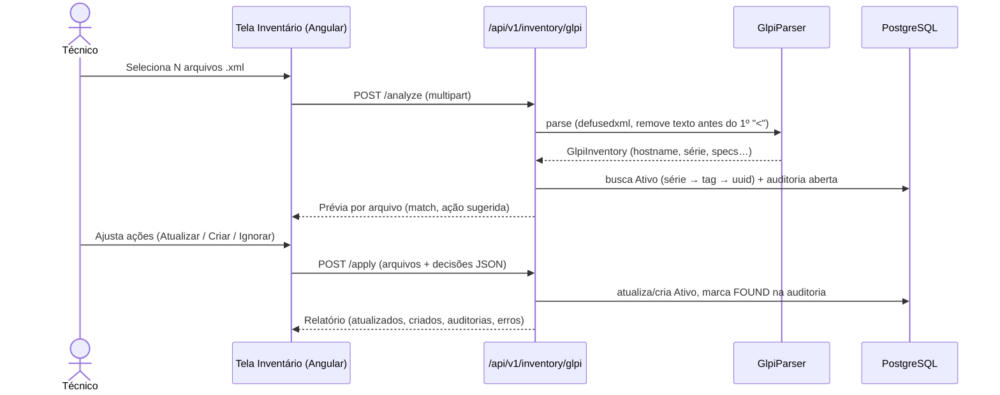

# Importação de Inventário GLPI (XML do GLPI Agent) no módulo de Inventário

> **Plano original (histórico).** A implementação seguiu um desenho menor; o que existe e o que ficou de fora está em [ADR-015](../decisions/ADR-015-importacao-inventario-glpi.md).

## Objetivo

Permitir que o técnico envie, pela tela de **Inventário Periódico**, um ou vários arquivos XML gerados pelo **GLPI Agent / FusionInventory** (formato `<REQUEST><CONTENT>…<QUERY>INVENTORY</QUERY>`, como o `docs/INVENTARIO_MODELO.xml` (local, fora do Git)). O sistema deve:

1. **Reconhecer** cada máquina e extrair um resumo de hardware e segurança.
2. **Casar** o arquivo com um Ativo existente, em cascata: **nº de série da BIOS → hostname = Tag → UUID**.
3. **Mostrar uma prévia** antes de gravar. Nela o usuário decide, para cada arquivo, entre *Atualizar*, *Criar novo ativo* (escolhendo unidade e categoria) ou *Ignorar*.
4. **Aplicar**: gravar as especificações no Ativo. Se houver uma **auditoria aberta** (`OPENED`/`IN_PROGRESS`) na unidade do ativo, marcar o item como `FOUND`.

Decisões já confirmadas com o responsável: fluxo completo (ativo + auditoria), casamento em cascata, prévia com criação manual, upload de vários arquivos e armazenamento só do **resumo de hardware + segurança**. A lista de softwares e o XML bruto **não** serão guardados.



---

## Itens para sua revisão

> [!IMPORTANT]
> **Mudança de schema:** três colunas novas na tabela `assets`, com uma migration Alembic nova encadeada no head atual `o5d6e7f8a9b0`:
> - `serial_number` (String 100, indexada, nullable): permite casar pelo nº de série com rapidez e confiabilidade.
> - `inventory_data` (JSONB, nullable): resumo estruturado vindo do GLPI (rede, monitores, antivírus etc.).
> - `last_inventory_at` (DateTime tz, nullable): data/hora do último inventário recebido.

> [!WARNING]
> **Dados sensíveis descartados de propósito:** `HARDWARE/WINPRODKEY` (chave do Windows), `LICENSEINFOS`, `ENVS`, `LOCAL_USERS`/`LOCAL_GROUPS` e `SOFTWARES` **não serão gravados**.

> [!NOTE]
> **Por que dois lugares para os dados?** A tela de detalhe do ativo mostra `technical_specs` como cartões chave → valor (`Object.entries`). Valores aninhados apareceriam como `[object Object]`. Por isso:
> - `technical_specs` recebe só **textos simples e legíveis** (CPU, RAM, Armazenamento, SO…), compatíveis com os cartões atuais;
> - `inventory_data` guarda a estrutura completa, exibida num **cartão novo "Inventário GLPI"**.
>
> A atualização faz *merge*: as chaves vindas do GLPI sobrescrevem as de mesmo nome, e as chaves cadastradas à mão continuam lá.

## Decisões confirmadas (antes eram perguntas em aberto)

1. **Ativo novo:** nome sugerido `"{Fabricante} {Modelo}"`. A **Tag é definida pelo usuário na hora**, na prévia. O hostname aparece só como sugestão inicial, o campo é obrigatório e editável, e a unicidade é validada.
2. **Status do ativo novo:** `IN_STOCK`, sem colaborador. O último usuário logado fica só como informação em `inventory_data`.
3. **Ativo em auditoria de outra unidade:** o sistema só avisa na prévia, sem transferir o ativo nem marcar a auditoria.
4. O arquivo real `docs/INVENTARIO_MODELO.xml` fica **fora do git** (`.gitignore`) e é usado só localmente.

---

## Mudanças propostas

### 1. Backend: dependência e modelo

#### [MODIFY] [pyproject.toml](../../backend/pyproject.toml)
Adicionar `defusedxml>=0.7.1`, um parser XML protegido contra XXE e "billion laughs". Instalação via `uv add defusedxml`.

#### [MODIFY] [assets/models.py](../../backend/app/assets/models.py)
```diff
+    serial_number: Mapped[str | None] = mapped_column(String(100), nullable=True, index=True)
+    inventory_data: Mapped[dict | None] = mapped_column(JSONB, nullable=True)
+    last_inventory_at: Mapped[datetime | None] = mapped_column(DateTime(timezone=True), nullable=True)
```

#### [NEW] `alembic/versions/p1a2b3c4d5e6_add_glpi_inventory_fields_to_assets.py`
`add_column` × 3 + `create_index('ix_assets_serial_number')`; o `downgrade` faz o inverso.

#### [MODIFY] [assets/schemas.py](../../backend/app/assets/schemas.py)
`AssetBase` ganha `serial_number: str | None = None`. `AssetResponse` ganha `inventory_data` e `last_inventory_at`, ambos somente leitura.

---

### 2. Backend: parser GLPI (puro, sem banco, fácil de testar)

#### [NEW] `backend/app/inventory_audit/glpi/parser.py`
- `parse_glpi_xml(raw: bytes) -> GlpiInventory`
  - Decodifica utf-8, com latin-1 como fallback.
  - **Descarta qualquer texto antes do primeiro `<`**. Isso trata o *"This XML file does not appear…"* que o navegador inclui ao copiar.
  - Valida a raiz `REQUEST` e se `QUERY == INVENTORY`. Se não bater, levanta `GlpiParseError` com uma mensagem amigável.
  - Normaliza valores-lixo (`None`, `No Asset Information`, `To be filled by O.E.M.`, `00000000`, `Default string`) para `None`.
- Campos extraídos (dataclass/pydantic `GlpiInventory`):

| Origem XML | Campo |
|---|---|
| `HARDWARE/NAME` | `hostname` |
| `HARDWARE/UUID` | `uuid` |
| `BIOS/SSN` (fallback `MSN`) | `serial` |
| `BIOS/ASSETTAG` | `asset_tag` (se válido) |
| `BIOS/SMANUFACTURER`, `SMODEL` | `manufacturer`, `model` |
| `HARDWARE/CHASSIS_TYPE` | `chassis` (Notebook/Desktop…) |
| `CPUS/NAME`, `CORE`, `THREAD` | `cpu` |
| `MEMORIES/*` + `HARDWARE/MEMORY` | `ram_total_mb`, módulos |
| `STORAGES/*` | discos físicos (modelo, tipo, tamanho, interface) |
| `OPERATINGSYSTEM/FULL_NAME`, `VERSION`, `ARCH` | `os` |
| `NETWORKS` (não virtuais, com MAC) | interfaces (descrição, MAC, IP) |
| `MONITORS` | fabricante, modelo, série |
| `VIDEOS/NAME` | `gpu` |
| `BATTERIES` | capacidade nominal × real (saúde %) |
| `ANTIVIRUS` | nome, ativo, atualizado |
| `FIREWALL` | perfis on/off |
| `USERS/LOGIN`, `HARDWARE/LASTLOGGEDUSER` | `last_user` |
| `ACCESSLOG/LOGDATE` | `inventory_date` |
| `DEVICEID`, `VERSIONCLIENT` | metadados do agente |

- `to_technical_specs()` gera o dicionário plano, por exemplo:
  `{"Fabricante": "LENOVO", "Modelo": "ThinkPad L14 Gen 2", "Nº de Série": "PE0C47SE", "Processador (CPU)": "11th Gen Intel Core i5-1135G7 @ 2.40GHz (4C/8T)", "Memória RAM": "24 GB (8 GB + 16 GB DDR4 3200)", "Armazenamento": "SSD NVMe 256 GB", "Sistema Operacional": "Microsoft Windows 11 Pro 25H2 (64-bit)", "GPU": "Intel(R) Iris(R) Xe Graphics"}`
  - As chaves foram escolhidas para que o [getSpecIcon](../../frontend/src/app/features/assets/asset-detail/asset-detail.component.ts#L297) atual acerte os ícones.
- `to_inventory_data()` gera o JSON estruturado: rede, monitores, discos, bateria, antivírus, firewall, último usuário, agente e data.

---

### 3. Backend: serviço e endpoints

#### [NEW] `backend/app/inventory_audit/glpi/schemas.py`
- `GlpiFilePreview`: `filename`, `ok`, `error`, `hostname`, `serial`, `manufacturer`, `model`, `summary` (specs planas), `match` (`asset_id`, `tag`, `name`, `unit_name`, `method: serial|tag|uuid`) ou `null`, `open_audits` (id e nome das auditorias abertas na unidade do ativo), `suggested_action: update|create`, `warnings[]`.
- `GlpiApplyDecision`: `filename`, `action: update|create|skip`, `asset_id?`, `create?: {tag, name, category_id, unit_id}`.
- `GlpiApplyResult`: contadores (`updated`, `created`, `skipped`, `audit_items_marked`, `errors`) e o detalhe por arquivo.

#### [NEW] `backend/app/inventory_audit/glpi/service.py`, classe `GlpiImportService`
- `analyze(files)`: faz o parse de cada arquivo (o erro de um não derruba os outros) e chama `_match_asset()`:
  1. `Asset.serial_number == serial` (fallback: `technical_specs["Nº de Série"]`);
  2. `Asset.tag` igual ao `hostname`, ignorando maiúsculas/minúsculas (depois ao `asset_tag` da BIOS);
  3. `inventory_data["uuid"] == uuid`.

  Considera só ativos não excluídos. Ativos `DECOMMISSIONED` geram aviso e a sugestão vira `skip`. Também gera aviso quando dois arquivos do mesmo lote apontam para o mesmo ativo.
- `apply(files, decisions, author_id)`: tudo numa única transação.
  - **update:** merge em `technical_specs`, mais `serial_number`, `inventory_data` e `last_inventory_at = now()`. Usa o repositório direto, já que não é movimentação (não muda status, unidade nem colaborador).
  - **create:** reaproveita `AssetService.create_asset()`, para manter a validação de tag única e a movimentação `INITIAL_STOCK`. Depois grava os campos do inventário.
  - **auditoria:** para cada auditoria `OPENED`/`IN_PROGRESS` da unidade do ativo, marca o `InventoryAuditItem` existente como `actual_status="FOUND"`, com a nota `"Confirmado via inventário GLPI em dd/mm/aaaa"`. Se o item não existir (ativo recém-criado), adiciona um com `FOUND`. Uma auditoria `OPENED` passa para `IN_PROGRESS` e recebe `start_date`, seguindo a regra já existente em `update_audit`.
- Limites: até **50 arquivos** por envio, **5 MB** por arquivo e só `.xml`, com HTTP 400/413 e mensagem clara.

#### [MODIFY] [inventory_audit/router.py](../../backend/app/inventory_audit/router.py)
Duas rotas novas, declaradas **antes** de `/{audit_id}` para não haver conflito de caminho:
```python
@router.post("/glpi/analyze", response_model=list[GlpiFilePreview],
             dependencies=[Depends(require_permission("inventory.write"))])
async def glpi_analyze(files: list[UploadFile] = File(...), db=Depends(get_db)): ...

@router.post("/glpi/apply", response_model=GlpiApplyResult,
             dependencies=[Depends(require_permission("inventory.write")),
                           Depends(require_permission("assets.write"))])
async def glpi_apply(files: list[UploadFile] = File(...), decisions: str = Form(...),
                     db=Depends(get_db), current_user_id=Depends(get_current_user_id)): ...
```
O apply recebe os arquivos de novo, sem estado no servidor, no mesmo padrão do `data_transfer` (`analyze` → `execute`). Assim não é preciso guardar arquivos temporários.

---

### 4. Frontend

#### [MODIFY] [inventory.service.ts](../../frontend/src/app/core/services/inventory.service.ts)
Interfaces `GlpiFilePreview` / `GlpiApplyDecision` / `GlpiApplyResult` e os métodos `glpiAnalyze(files: File[])` e `glpiApply(files, decisions)`, ambos com `FormData`.

#### [NEW] `features/inventory/glpi-import-dialog/glpi-import-dialog.component.{ts,html,scss}`
Diálogo standalone (Angular Material) em três etapas:
1. **Upload:** área de arrastar e soltar com múltiplos `.xml`, lista dos arquivos e botão *Analisar*.
2. **Prévia:** uma linha por arquivo com ícone do chassi, hostname, modelo, série e um chip do match (`Encontrado por série` / `por tag` / `Novo` / `Erro`), além das auditorias abertas que serão marcadas. Cada linha tem um seletor de ação; em *Criar*, aparecem Tag, Nome, Unidade e Categoria, já preenchidos com as sugestões. Uma linha expansível mostra o resumo de hardware.
3. **Resultado:** cartões com os contadores, a lista de erros e um botão *Fechar*, que recarrega a lista de auditorias.

#### [MODIFY] [inventory-list.component.html](../../frontend/src/app/features/inventory/inventory-list/inventory-list.component.html) / [.ts](../../frontend/src/app/features/inventory/inventory-list/inventory-list.component.ts)
Botão `mat-stroked-button` **"Importar GLPI"** (ícone `upload_file`) ao lado de *Nova Auditoria*, que abre o diálogo.

#### [MODIFY] [asset-detail.component.ts](../../frontend/src/app/features/assets/asset-detail/asset-detail.component.ts) / [.html](../../frontend/src/app/features/assets/asset-detail/asset-detail.component.html)
- `specEntries` passa a filtrar valores que não são primitivos, como proteção extra.
- Cartão novo **"Inventário GLPI"**, exibido só se `inventory_data` existir: data do último inventário, último usuário, rede (MAC/IP), monitores, bateria (saúde %), antivírus e firewall com chips verde/vermelho.
- Interface `Asset` em `asset.service.ts` com os campos novos.

---

### 5. Testes e documentação

#### [NEW] `backend/tests/fixtures/glpi_inventory_sample.xml`
Cópia do modelo **sem** dados sensíveis (chave do Windows e licença removidas), mantendo o preâmbulo do navegador para testar a limpeza.

#### [NEW] `backend/tests/test_glpi_parser.py` (unitário, sem banco)
- Parse do arquivo de exemplo: hostname `IV-1038`, série `PE0C47SE`, RAM de 24 GB, CPU i5-1135G7, Windows 11 Pro e 2 discos.
- O preâmbulo é ignorado; XML inválido ou com `QUERY` diferente gera `GlpiParseError`.
- Valores-lixo viram `None`; `WINPRODKEY` não aparece em lugar nenhum da saída.
- XML com entidade externa (XXE) é rejeitado.

#### [NEW] `backend/tests/test_glpi_import.py` (API, SQLite in-memory do conftest)
- `analyze` casa por série, por tag e retorna "novo" quando não acha.
- `apply` com *update*: specs mescladas, `last_inventory_at` preenchido e item da auditoria aberta marcado `FOUND`.
- `apply` com *create*: ativo criado, movimentação `INITIAL_STOCK` gerada e item `FOUND` adicionado à auditoria.
- Auditoria `CLOSED` não é alterada; ativo `DECOMMISSIONED` não é atualizado.
- Sem a permissão `inventory.write`, a resposta é 403.

#### [MODIFY] [docs/user-guide.md](../../docs/user-guide.md)
Seção nova "Importar inventário do GLPI Agent", com o passo a passo e um comando de exemplo para gerar o XML: `glpi-inventory --xml > maquina.xml` ou `glpi-agent --local=C:\inventarios`.

---

## Plano de verificação

### Testes automatizados
```powershell
# backend
cd backend
uv add defusedxml
uv run pytest tests/test_glpi_parser.py tests/test_glpi_import.py tests/test_inventory_audit.py -v
uv run pytest            # suíte completa, sem regressões
uv run ruff check app tests
uv run alembic upgrade head ; uv run alembic downgrade -1 ; uv run alembic upgrade head   # migration reversível

# frontend
cd ../frontend
npx ng build
```

### Verificação manual (navegador)
1. Subir o ambiente (`docker compose up` ou dev server) e abrir **Inventário Periódico**.
2. Criar uma auditoria aberta na unidade de um ativo de tag `IV-1038`, cadastrando esse ativo antes se for preciso.
3. Clicar em **Importar GLPI** e enviar o `INVENTARIO_MODELO.xml` → a prévia deve mostrar *Encontrado por tag* e a auditoria que será marcada.
4. Aplicar → abrir a auditoria e ver o item `FOUND`; abrir o ativo e ver a Ficha Técnica preenchida e o cartão "Inventário GLPI".
5. Repetir com um XML de hostname desconhecido → escolher *Criar*, informar unidade e categoria e conferir o ativo novo.

